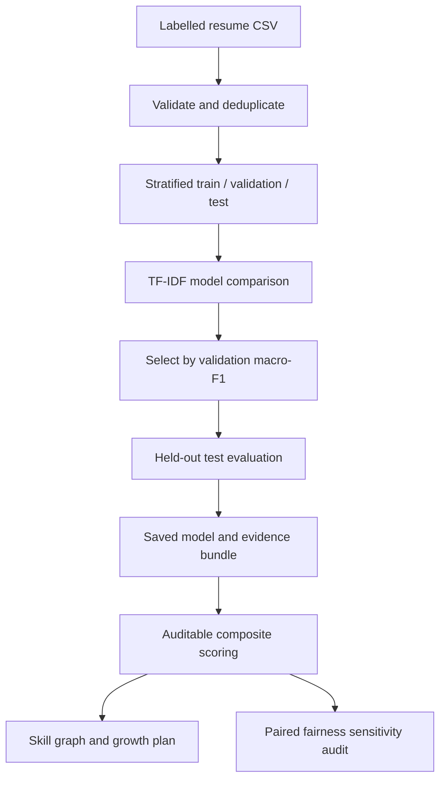

# CareerFit Phase 6 — Fairness Sensitivity Auditing

CareerFit is an explainable resume-intelligence project. This package contains the
completed Phase 1 resume parser, Phase 2 requirement matcher, Phase 3
machine-learning foundation, Phase 4 composite-scoring engine, Phase 5
growth-potential engine, and Phase 6 fairness sensitivity audit.

Phase 3 validates labelled resume data, blocks exact duplicate leakage, creates
fixed stratified train/validation/test partitions, compares three TF-IDF models,
selects the winner on validation macro-F1, evaluates it once on the held-out test
set, and saves a reusable model with a complete evidence bundle.

Phase 4 converts text similarity, target-role probability, and transparent
requirement coverage into a traceable fit score. It records the exact arithmetic,
supports validated custom weights, allows an explicit target-role override, and
never allows the fit score to override mandatory eligibility.

Phase 5 maps missing job skills to an acyclic prerequisite graph, removes skills
the candidate already knows, estimates a learning path, and simulates the score
after learning. The simulation conservatively changes only requirement coverage;
text similarity and ML role probability remain fixed until a new résumé is uploaded.

Phase 6 compares the standard score with a diagnostic score after masking names,
contact details, gendered pronouns, honorifics, and recognizable institution names.
It preserves structured qualifications, measures score and rank sensitivity, and
can only flag a case for human review; it never changes eligibility or auto-rejects.

## What is completed

### Phase 1 — Resume processing

- Parse PDF, DOCX, and TXT resumes
- Extract identity, links, skills, education, experience, and certifications
- Normalize skill names through a configurable taxonomy
- Keep identity fields separate from job-relevant features

### Phase 2 — Transparent requirements

- Parse job descriptions and classify mandatory/preferred requirements
- Check skills, experience, degree, field, and certifications
- Keep mandatory eligibility independent of weighted coverage
- Rank candidates and explain failures and skill gaps

### Phase 3 — ML classification

- Validate labelled CSV datasets and report class balance
- Remove exact/normalized duplicates before splitting
- Reject duplicate text carrying conflicting labels
- Create deterministic stratified train/validation/test partitions
- Train TF-IDF + Logistic Regression, Linear SVM, and Random Forest
- Select the best model using validation macro-F1
- Refit the selected model on train + validation data
- Evaluate once on the untouched test data
- Save the model, metrics, predictions, confusion matrix, split manifest, and model card
- Predict a broad role and probability distribution for new resumes
- Remove extracted names, emails, phone numbers, and profile URLs before ML inference

### Phase 4 — Explainable composite scoring

- Calibrate Linear SVM confidence with three-fold sigmoid calibration
- Infer the job's target role or accept an explicit reviewed override
- Warn when model-inferred job-role confidence is below 0.50
- Validate and normalize custom component weights
- Record each weighted contribution and the exact final-score arithmetic
- Preserve Phase 2 mandatory eligibility during every ranking

### Phase 5 — Graph-backed growth recommendations

- Validate a 55-node directed graph against the canonical skill taxonomy
- Reject missing prerequisites, invalid estimates, self-links, and cycles
- Prioritize missing mandatory skills before preferred and relevant skills
- Produce prerequisite-aware learning paths and deduplicate combined plans
- Estimate planning hours while labelling them as non-guaranteed heuristics
- Recalculate requirement coverage, potential fit, and eligibility using existing engines
- Keep text similarity and role probability fixed during conservative simulations

### Phase 6 — Fairness sensitivity auditing

- Remove known names and contact details before diagnostic rescoring
- Mask gendered pronouns, honorifics, and recognizable institution names
- Preserve skills, experience, degrees, fields of study, and certifications
- Compare paired standard and masked component scores and diagnostic ranks
- Estimate normal variation with median and median absolute deviation for cohorts of five or more
- Use a conservative minimum threshold for smaller cohorts and disclose the limitation
- Flag meaningful sensitivity for human review without changing the original decision
- Avoid inferring protected attributes or claiming that sensitivity testing proves fairness

## System flow



## 1. Set up on Windows PowerShell

```powershell
cd CareerFit_Phase6
py -3.13 -m venv .venv
.venv\Scripts\Activate.ps1
python -m pip install --upgrade pip
python -m pip install -r requirements.txt
```

The package pins scikit-learn 1.8.0 because serialized scikit-learn models should
be loaded with the same version that trained them. This prevents the model-version
warning seen when the Phase 5 demo model was opened with scikit-learn 1.9.1.

If activation is blocked, run this once in the current terminal:

```powershell
Set-ExecutionPolicy -Scope Process -ExecutionPolicy Bypass
.venv\Scripts\Activate.ps1
```

## 2. Run all tests

```powershell
python -m unittest discover -s tests -v
```

Python 3.13 is recommended on Windows. The verified package contains 50 tests
across all six phases.

## 3. Understand the dataset format

The required CSV columns are:

| Column | Meaning |
|---|---|
| `record_id` | Unique row identifier; generated when absent |
| `resume_text` | Resume text without identity fields |
| `target_role` | Correct broad job-role class |

Example:

```csv
record_id,resume_text,target_role
001,"Python SQL pandas machine learning and model evaluation",Data Scientist
002,"React TypeScript Node.js REST API and PostgreSQL",Full Stack Developer
```

The training loader removes email, phone, and URL patterns, but names cannot be
reliably detected in arbitrary raw CSV text. Supply identity-free `resume_text`.

Keep a provenance manifest beside the CSV using the name
`<dataset-name>.manifest.json`. It should document the source, licence, collection
method, labelling procedure, limitations, and allowed claims.

## 4. Validate data before training

```powershell
python app.py validate-dataset ".\samples\demo_resume_dataset.csv" --output ".\output\dataset_audit.json"
```

Validation fails when required columns are missing, fewer than two classes exist,
a class has too few unique samples, record IDs repeat, or identical resume text has
conflicting labels.

## 5. Train and evaluate all models

```powershell
python app.py train `
  --dataset ".\samples\demo_resume_dataset.csv" `
  --artifacts ".\output\demo_model" `
  --seed 42 `
  --output ".\output\training_summary.json"
```

The artifact directory contains:

| File | Purpose |
|---|---|
| `careerfit_role_model.joblib` | Selected fitted pipeline |
| `evaluation_report.json` | Validation comparison and final test metrics |
| `dataset_audit.json` | Counts, duplicates, balance, and fingerprint |
| `split_manifest.json` | Exact record IDs and fingerprints in each partition |
| `confusion_matrix.csv` | Held-out actual-versus-predicted counts |
| `test_predictions.csv` | Record-level test predictions |
| `MODEL_CARD.md` | Intended use, result summary, and limitations |

The included dataset is synthetic and only proves that the pipeline works. Its
metrics must not be presented as CareerFit's real-world accuracy.

## 6. Predict roles for new resumes

```powershell
python app.py predict-role `
  --model ".\output\demo_model\careerfit_role_model.joblib" `
  --resumes ".\samples\sample_resume.txt" ".\samples\sample_resume_gap.txt" `
  --output ".\output\role_predictions.json"
```

The result includes the predicted role, confidence, and a distribution across
every role learned from the dataset.

Linear SVM uses three-fold sigmoid calibration within the training partition.
Native Logistic Regression and Random Forest probabilities should still be
checked for calibration when a representative real dataset becomes available.

## 7. Run the complete hybrid score

```powershell
python app.py score `
  --model ".\output\demo_model\careerfit_role_model.joblib" `
  --job ".\samples\sample_job_description.txt" `
  --resumes ".\samples\sample_resume.txt" ".\samples\sample_resume_gap.txt" `
  --output ".\output\hybrid_scores.json"
```

The hybrid score is:

```text
fit score = 0.40 × text similarity
          + 0.40 × target-role probability
          + 0.20 × requirement coverage
```

Eligibility remains separate. A high ML score never hides a missing mandatory
skill, insufficient experience, missing degree, or mandatory certification.

The JSON contains `scoring_context`, `component_weights`, and
`component_contributions`, so the displayed result can be recalculated exactly.

To review the role manually or change the relative emphasis:

```powershell
python app.py score `
  --model ".\output\demo_model\careerfit_role_model.joblib" `
  --job ".\samples\sample_job_description.txt" `
  --resumes ".\samples\sample_resume.txt" `
  --target-role "Data Scientist" `
  --similarity-weight 30 `
  --role-weight 30 `
  --requirement-weight 40 `
  --output ".\output\reviewed_scores.json"
```

Weights may use proportions or percentages; CareerFit normalizes them to total 1.0.
Negative, non-numeric, incomplete, or all-zero weight sets are rejected.

## 8. Generate Phase 5 growth plans

```powershell
python app.py growth `
  --model ".\output\demo_model\careerfit_role_model.joblib" `
  --job ".\samples\sample_job_description.txt" `
  --resumes ".\samples\sample_resume.txt" ".\samples\sample_resume_gap.txt" `
  --max-recommendations 5 `
  --output ".\output\growth_plans.json"
```

Each candidate receives individual recommendations and a deduplicated combined
learning path. `score_gain` is calculated by the same Phase 4 weights. A candidate
may remain ineligible after learning if a non-skill requirement, such as experience,
still fails.

Use `--graph` to supply a reviewed custom graph. Custom files receive the same
taxonomy, metadata, positive-hours, and acyclicity validation.

## 9. Run the Phase 6 fairness sensitivity audit

```powershell
python app.py fairness-audit `
  --model ".\output\demo_model\careerfit_role_model.joblib" `
  --job ".\samples\sample_job_description.txt" `
  --resumes ".\samples\sample_resume.txt" ".\samples\sample_resume_gap.txt" `
  --output ".\output\fairness_audit.json"
```

The audit reports the standard score, masked diagnostic score, component changes,
rank changes, applied review threshold, and masking counts without exporting the
masked résumé text. The standard score, rank, and mandatory eligibility remain the
authoritative result.

For five or more candidates, the default threshold uses the cohort median plus
three scaled median absolute deviations, with a 0.01 minimum. Smaller cohorts use
the minimum and include a reliability warning. A reviewed threshold can be supplied
with `--review-threshold`; the score scale is 0 to 1.

## 10. Why three partitions are used

- **Training set:** fits model parameters and TF-IDF vocabulary.
- **Validation set:** compares Logistic Regression, SVM, and Random Forest.
- **Test set:** estimates the selected model's performance on unseen data.

Using the test set to choose a model would leak information and make the reported
result overly optimistic.

## 11. Why macro-F1 selects the model

Accuracy can look strong even when a smaller class performs poorly. Macro-F1
calculates F1 for each class and gives each class equal importance. Accuracy is
used only as a tie-breaker.

## 12. Existing Phase 1 and Phase 2 commands

```powershell
python app.py parse ".\samples\sample_resume.txt"
python app.py parse-job ".\samples\sample_job_description.txt"
python app.py match --job ".\samples\sample_job_description.txt" --resumes ".\samples\sample_resume.txt"
```

## 13. Project structure

```text
CareerFit_Phase6/
├── app.py
├── requirements.txt
├── samples/
│   ├── demo_resume_dataset.csv
│   ├── demo_resume_dataset.manifest.json
│   ├── sample_job_description.txt
│   └── sample_resume*.txt
├── careerfit/
│   ├── parsing/ and extraction/
│   ├── job/ and matching/
│   ├── ml/
│   │   ├── dataset.py
│   │   ├── evaluation.py
│   │   ├── training.py
│   │   ├── inference.py
│   │   └── similarity.py
│   ├── scoring/hybrid.py
│   ├── growth/
│   │   ├── skill_graph.json
│   │   ├── graph.py
│   │   └── engine.py
│   └── fairness/
│       ├── masking.py
│       ├── audit.py
│       └── models.py
└── tests/
```

## 14. Current limitations

- The bundled dataset is synthetic and too small for a defensible performance claim.
- Only exact/normalized duplicate detection is implemented; semantic near-duplicates
  should also be reviewed in a real dataset.
- TF-IDF captures word patterns better than meaning or context.
- Broad role labels depend entirely on the supplied labelled dataset.
- Scanned PDFs still require OCR.
- Probability quality still requires checking on a real representative dataset.
- Graph relationships and hour estimates are starter heuristics requiring expert review.
- Growth simulation does not assume that learning instantly changes résumé language or ML confidence.
- Institution-name masking is heuristic; ambiguous acronyms are retained and flagged.
- Paired masking detects sensitivity but cannot prove the absence of discrimination.
- Group fairness metrics require lawful, representative, consented demographic evaluation data.
- CareerFit is decision support; it must not autonomously reject applicants.

## Next milestone

Phase 7 will add repeated linear-search, binary-search, and Python `set` lookup
benchmarks, Matplotlib evaluation charts, and a separate-process Pygame skill-gap
explorer. Real-world ML claims still require a documented real dataset and evidence sheet.
# Phase 8 desktop update

Launch `python app.py gui`. See [PHASE8.md](PHASE8.md) for Windows setup, workflow instructions and remaining evaluation work.

# Phase 7 update

See [PHASE7.md](PHASE7.md) for search commands, Pygame controls and algorithm limitations. The Phase 6 instructions below remain available for the earlier workflows.

